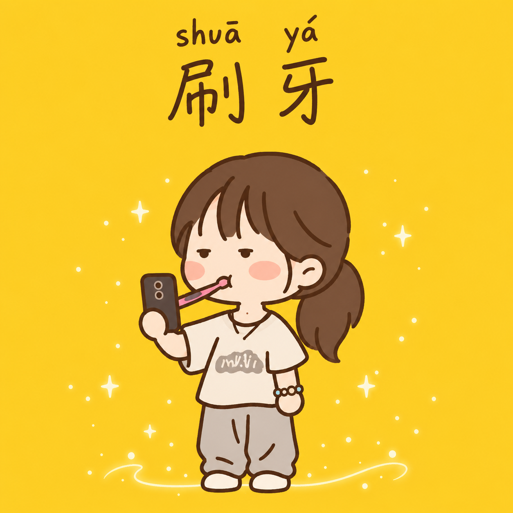

# Wibi Style · 明黄软萌Q版手绘

适合单人、双人或人宠同框的日常随手拍与自拍，重绘为明黄纯色底、2.5头身极简手账小人并配原创手写中文拼音标题。

当前版本：`v1.0.0`

作者：`@威比 Hunter Wei.`（抖音、小红书同名）

## 成图示例

以下仅展示本 Skill 的实际生成结果，不包含用户原始照片。

<p align="center">
  
  
  
  <br />
  
  
  
</p>

## 安装

```text
请安装这个 Skill：
https://github.com/Vieeeeeee/wibi-style/tree/main/skills/yellow-chibi-doodle
```

安装器只下载这一款 Skill。装完不用做别的，第一次调用时它会自己打招呼并告诉你下一步。

本款运行需要的参考图：`0` 张。需要时已放在 Skill 自己的 `assets/references/` 中，会随本款一起安装；用户无需再次上传。

## 使用与授权

个人非商业使用；商业使用请先联系作者。复制、修改、转发、镜像或重新打包时，必须保留 `@威比 Hunter Wei.`、抖音、小红书同名、官方来源、`LICENSE` 与 `NOTICE`。
